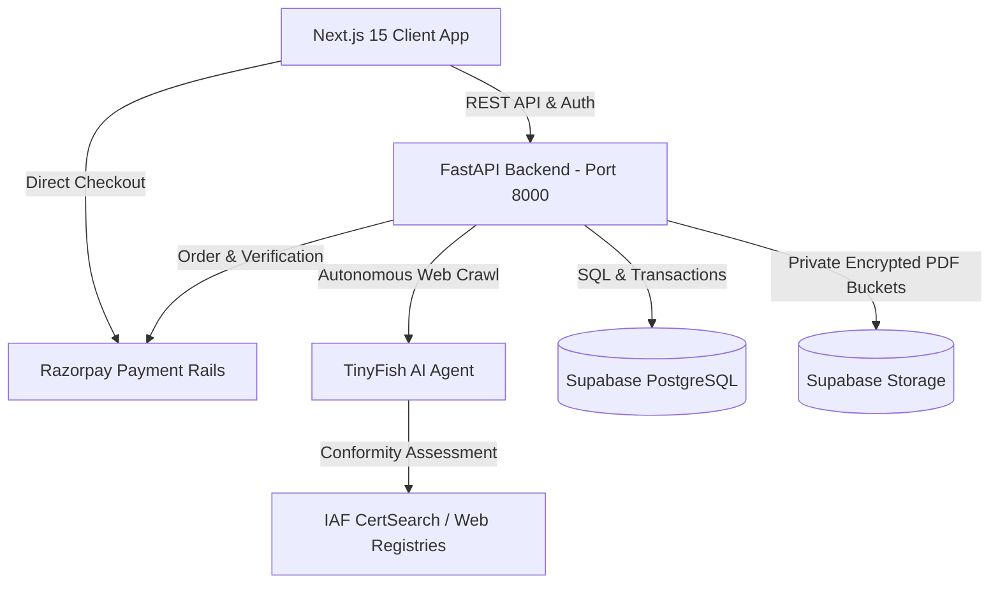

# TrustChain AI — The Last Check Before You Pay

<div align="center">


**Evidence-Backed Pre-Advance Purchasing Verification & B2B Trust Infrastructure for Indian Manufacturing MSMEs**  
*Built with ❤️ by Team Ashwamedha for HackIIITD 2026*

[Features](#-key-features) • [TinyFish Agent](#-tinyfish-autonomous-web-agent-integration) • [Architecture](#-system-architecture) • [API Contract](#-api-endpoints) • [Quick Start](#-quick-start-guide)

</div>

---

## 📌 The Problem We Are Solving

Small and medium manufacturing enterprises (MSMEs) in India source hundreds of crores in raw materials (precision steel blanks, alloy forgings, copper rods) from unfamiliar suppliers. When negotiating orders, buyers face immense risk:

1. **Silent Specification Downgrades:** Between the *Accepted Quotation* and the *Final Proforma Invoice (PI)*, shady vendors silently downgrade technical specifications (e.g., swapping **8.00 mm precision engineering plate** for **6.00 mm commercial grade**), saving the vendor 25% while causing catastrophic failure in production.
2. **Advance Demand Escalations:** Suppliers suddenly escalate advance commitments right before dispatch (e.g., jumping from **30% advance** up to **80% upfront**), leaving the buyer with massive unbacked risk.
3. **Substandard Material & Fake MTCs:** Vendors often supply forged Mill Test Certificates (EN 10204 3.1) from uncertified secondary re-roller furnaces with excessive Carbon and Sulphur impurities.
4. **No Centralized B2B Trust Infrastructure:** Unlike retail credit (CIBIL), there is no centralized trust database or rating system for Indian manufacturing raw material suppliers.

---

## 🛡️ The TrustChain AI Solution

**TrustChain AI** is the automated forensic firewall that checks procurement transactions **before money leaves your business**:

```
[ Accepted Quotation ] ──┐
                         ├──► [ TrustChain AI Forensic Engine ] ──► [ Milestone-Governed Razorpay ]
[ Final Proforma Invoice ] ──┘            ▲                ▲
                                          │                │
                        [ TinyFish Live Web Agent ]   [ Digital MTC Verifier ]
```

* **Line-Item Diffing Engine:** Compares quote and invoice terms, calculating the exact financial advance exposure increase down to the rupee.
* **TinyFish Autonomous Web Agent:** Autonomously browses the live internet to audit supplier websites, plant equipment, and global **IAF CertSearch** accreditation databases.
* **Digital Mill Test Certificate (MTC) Verifier:** Inspects spectrometer chemical composition (C, Mn, Si, S, P) and physical thickness, automatically generating source-linked **Non-Conformance Reports (NCR)**.
* **Razorpay Milestone Settlement:** Disburses only the agreed 30% advance while locking the remaining 50% capital in escrow until physical quality passes inspection.
* **Centralized B2B Vendor Trust Directory (`/vendors`):** Benchmarks suppliers into Tier A (Prime), Tier B (Caution), and Tier C (Severe Risk) based on empirical pass rates.

---

## 🚀 Key Features

### 1. Line-Item Discrepancy & Advance Exposure Engine (`/cases/[id]/findings`)
* Ingests RFQ, Accepted Quotation, and Final Proforma Invoice.
* Detects specification downgrades (e.g., `8.00 mm` -> `6.00 mm`).
* Computes **Additional Advance Exposure** mathematically:
  $$\text{Exposure} = \text{Invoice Demand (80\%)} - \text{Agreed Advance (30\%)} = \mathbf{₹2,40,000}$$
* Flags lead-time deviations (7 days -> 20 days) and price variations.

### 2. Centralized B2B Vendor Trust Directory (`/vendors`)
* Comprehensive directory of Indian raw material mills and fabricators.
* **Empirical Trust Index (0–100)**: Evaluates IAF certifications, historical quality pass rates, and dispute frequency.
* **Tiered Classifications**:
  * **Tier A (Prime / Institutional):** BIS & IAF MLA accredited, $\ge 98\%$ quality pass rate.
  * **Tier B (Caution / Moderate Risk):** Good pricing, but unaccredited ISO claims and historical gauge deviations. Advance capped at 30%.
  * **Tier C (Severe Risk / Unverified):** High dispute rate ($>50\%$), 0% advance permitted (full escrow only).
* Real-time search by GSTIN, mill name, location, and material category.

### 3. Digital Mill Test Certificate (MTC) Verifier (`/cases/[id]/mtc`)
* **Spectrometer Chemical Analysis:** Checks Carbon ($C \le 0.18\%$), Manganese ($Mn \le 1.40\%$), Silicon ($Si \le 0.40\%$), Sulphur ($S \le 0.040\%$), and Phosphorus ($P \le 0.040\%$) against IS 2062:2011 standards.
* **Mechanical & Dimensional Tests:** Checks gauge thickness deficit (-25%), yield strength ($R_{eH}$), and ultrasonic lamination scans.
* **Heat Batch Ladle Traceability:** Verifies Heat Batch `HT-2026-9921B` against primary blast furnace records to detect secondary re-roller substitution.
* **One-Click Non-Conformance Notice (NCR):** Dispatches formal dispute notices (`NCR-XXXXXX`), freezing unhedged milestone funds.

### 4. Razorpay Milestone-Governed Settlement Gateway (`/cases/[id]/payment`)
* Direct supplier settlement powered by **Razorpay B2B rails**.
* Enforces milestone governance: Buyer disburses only the safe **30% Advance (₹1,44,000)** and hedges the remaining **50% (₹2,40,000)** buffer.
* Native checkout dialog supporting **UPI**, **NetBanking**, **NEFT/RTGS**, and **Corporate Cards** with bank-grade 256-bit SSL encryption.
* Generates verifiable payment vouchers (`RCPT-XXXXXX`) logged into an **Audited Disbursement Ledger**.

### 5. Accountable Human-in-the-Loop Review (`/cases/[id]/review`)
* AI suggests decisions; human procurement managers retain accountability.
* Options: **Approve**, **Request Clarification**, or **Reject**.
* Logs immutable audit records with timestamps and digital signatures.

### 6. Executive Audit Reports (`/cases/[id]/reports`)
* One-click printable, formal executive PDF report for CFOs, procurement heads, and bank escrow agents.
* Every finding is linked to exact document page coordinates, spectrometer lab charts, and TinyFish web citations.

---

## 🌐 TinyFish Autonomous Web Agent Integration

TrustChain AI integrates **TinyFish** as an autonomous web research sub-agent:

```
[ Buyer Input URL ] 
        │
        ▼
[ FastAPI Backend ] ──► GET /api/v1/tinyfish/live-analyze?url=https://www.iafcertsearch.org/
        │
        ▼
[ TinyFish Agent ] ──► Headless browser navigates IAF CertSearch database
        │
        ▼
[ Live Extraction ] ──► Finds "0 Active Accredited Certifications for Kaveri Metalworks"
        │
        ▼
[ Evidence Trace ] ──► Displayed in /cases/[id]/evidence with timestamp & source citation
```

* **Zero Hallucination:** Every claim made by the AI is backed by an external URL and verifiable citation.
* **Interactive Testing:** Users and judges can enter any supplier website live in the UI search bar to execute a real-time forensic crawl.

---

## 🏗️ System Architecture



---

## 🔌 API Endpoints

| Method | Endpoint | Description |
| :--- | :--- | :--- |
| `GET` | `/health` | Backend service health check |
| `GET` | `/api/v1/vendors` | Search audited B2B supplier database (`q`, `tier`) |
| `GET` | `/api/v1/vendors/{id}` | Retrieve specific vendor profile |
| `GET` | `/api/v1/cases/{id}/mtc` | Retrieve Mill Test Certificate & spectrometer results |
| `POST` | `/api/v1/cases/{id}/mtc/verify` | Verify heat batch ladle origin |
| `POST` | `/api/v1/cases/{id}/mtc/dispute` | Dispatch official Non-Conformance Notice (NCR) |
| `POST` | `/api/v1/payments/create-order` | Generate Razorpay Order with milestone metadata |
| `POST` | `/api/v1/payments/verify` | Authenticate payment signature & issue voucher |
| `GET` | `/api/v1/cases/{id}/payments` | Retrieve case disbursement history & ledger |
| `GET` | `/api/v1/tinyfish/live-analyze` | Trigger TinyFish autonomous research run |
| `GET` | `/api/v1/cases` | List user procurement investigations |
| `POST` | `/api/v1/cases` | Create new procurement case |

---

## 💻 Tech Stack

* **Frontend:** Next.js 15, React 19, TypeScript, Vanilla CSS Design System, Lucide Icons.
* **Backend:** Python 3.14, FastAPI, Pydantic v2, Uvicorn (StatReload).
* **Database & Auth:** Supabase PostgreSQL, Row-Level Security (RLS), S3-compatible private storage.
* **AI & External APIs:** TinyFish Autonomous Web Agent API, Razorpay Payment Gateway.

---

## ⚡ Quick Start Guide

### 1. Clone & Configure Environment

```bash
git clone https://github.com/priyansh-sinha2109/TrustChain_Ai.git
cd TrustChain_Ai
```

Ensure your `.env` is configured in the root directory:

```env
FRONTEND_ORIGIN=http://localhost:3000
ENVIRONMENT=development
SUPABASE_URL=https://<your-project>.supabase.co
SUPABASE_ANON_KEY=<your-anon-key>
SUPABASE_SERVICE_ROLE_KEY=<your-service-role-key>
DATABASE_URL=postgresql://<user>:<password>@<host>:5432/postgres?sslmode=require
TINYFISH_API_KEY=sk-tinyfish-<your-key>
REPOSITORY_FACTORY=app.supabase_adapter:create_repository
PUBLIC_RESEARCH_HOSTS=*,example.com,iafcertsearch.org
```

### 2. Start Backend (FastAPI)

```bash
# From workspace root
python -m uvicorn app.main:create_app --factory --app-dir backend --port 8000 --reload
```
* Backend will be live at: `http://localhost:8000`
* Interactive API Documentation (Swagger): `http://localhost:8000/docs`

### 3. Start Frontend (Next.js)

```bash
cd frontend
npm install
npm run dev
```
* Frontend will be live at: `http://localhost:3000`

---

## 👥 Team Ashwamedha — HackIIITD 2026

* **Priyansh Sinha** — Backend & AI Agent Architecture
* **Gaurav Tiwari** — Frontend Architecture & UI/UX Implementation
* **Anjali Singh** — Database Architecture, Supabase & Security Modeling

---

<div align="center">
<b>TrustChain AI</b> — <i>Protecting Indian Manufacturing MSMEs from Procurement Fraud.</i>
</div>
